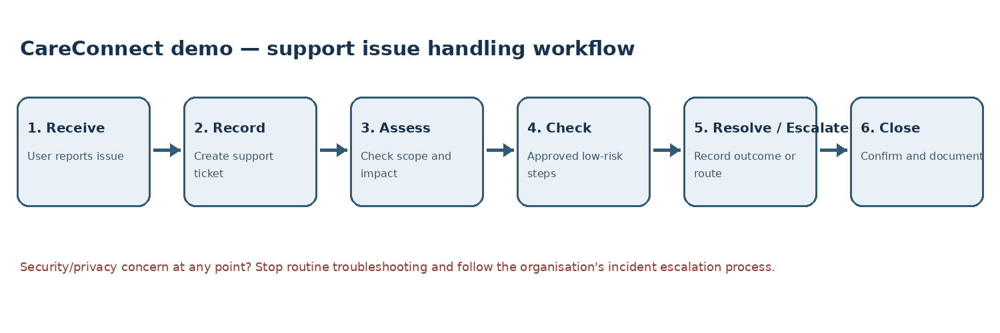

# SOP: Triage and Documentation of User Access Issues

**Document ID:** OPS-SOP-002 | **Version:** 2.0 | **Status:** Demonstration draft  
**Process owner:** Fictional Support Operations Team  
**Applies to:** Authorised first-line support personnel

> This fictional procedure is a writing sample, not an approved incident-response, privacy, security, or clinical policy. An organisation's own approved procedures always take precedence.

## 1. Purpose
Establish a consistent method to receive, record, assess, perform permitted first-line checks, resolve, or escalate user access issues.

## 2. Scope and exclusions
Covers routine sign-in and access problems. It does not authorise staff to bypass authentication, impersonate users, access records outside their role, investigate suspected compromise independently, or provide clinical advice.

## 3. Roles
| Role | Responsibility |
|---|---|
| First-line support | Record the report, perform approved checks, document results, and escalate when required |
| Support lead | Review priority and routing where the process requires |
| Security/privacy team | Handle suspected security or privacy incidents through approved procedures |
| Product/technical team | Investigate application defects and service-level issues |

## 4. Required safeguards
- Never request or record passwords, one-time codes, or full authentication secrets.
- Collect only information necessary to diagnose and route the issue.
- Use approved ticketing and communication systems.
- Follow identity-verification requirements before discussing account-specific information.
- Do not include unnecessary health or personal information in ticket summaries.
- If a security or privacy concern is suspected, stop routine troubleshooting and use the approved incident route.

## 5. Procedure
### 5.1 Receive and acknowledge
1. Acknowledge the report using the approved support channel.
2. Confirm the user's preferred safe contact method.
3. Ask for a concise description of the problem and when it began.
4. Do not ask the user to send passwords, verification codes, or screenshots containing sensitive information.

### 5.2 Create or update the ticket
Record:
- Date and time received, including time zone where relevant.
- Affected service or feature.
- Concise issue summary and exact error wording, if safe to record.
- Browser/device details only when relevant and permitted.
- Steps already attempted and their outcomes.
- Impact (one user, multiple users, or broader service impact).
- Ticket owner, priority under local policy, and next action.

### 5.3 Assess impact and risk
1. Determine whether one user or multiple users are affected.
2. Check approved service-status notices.
3. Identify any indication of unauthorised access, exposed information, or unusual account activity.
4. Apply the organisation's priority and escalation rules; do not invent severity levels.

### 5.4 Perform approved first-line checks
1. Confirm the user is using the official sign-in address.
2. Check for known service notices.
3. Confirm the browser is supported using approved guidance.
4. Ask the user to check for accidental spaces in the email address.
5. If permitted by policy, suggest a fresh browser session or approved password-reset route.
6. Record each action and result.

Do not disable security controls, request secrets, or attempt access as the user.

### 5.5 Resolve or escalate
- If an approved check resolves the issue, provide the verified steps and ask the user to confirm access is restored.
- If the issue persists, route it to the appropriate technical team with the ticket history.
- If there is a suspected security/privacy incident, stop routine checks and immediately follow the organisation's incident-reporting process.
- If the user describes an urgent clinical concern, direct them to the organisation's approved clinical contact or emergency process; support staff must not triage clinical risk unless authorised and trained.

### 5.6 Close or leave pending
Close only when resolution and closure criteria are met and the actions are documented. If awaiting user confirmation or another team, use the approved pending status and follow-up interval.

## 6. Workflow

*Figure 1. High-level fictional workflow. Security/privacy escalation can override routine steps at any point.*

## 7. Quality checklist
- [ ] Ticket summary is factual, concise, and time-stamped.
- [ ] No password or verification code was requested or recorded.
- [ ] User impact and relevant error details are documented.
- [ ] Actions and outcomes are recorded.
- [ ] Correct approved escalation route is used.
- [ ] User communication is respectful and accessible.
- [ ] Ticket closure or pending status follows local policy.

## 8. Records and review
Store records only in approved systems and according to organisational retention, privacy, and access-control policies. Review this SOP when the workflow, application, or governing policy changes.

## 9. Approval and revision history
| Version | Change | Approval |
|---|---|---|
| 1.0 | Initial demonstration draft | Not approved |
| 2.0 | Added role clarity, privacy safeguards, impact assessment, escalation and workflow diagram | Pending fictional process-owner review |
