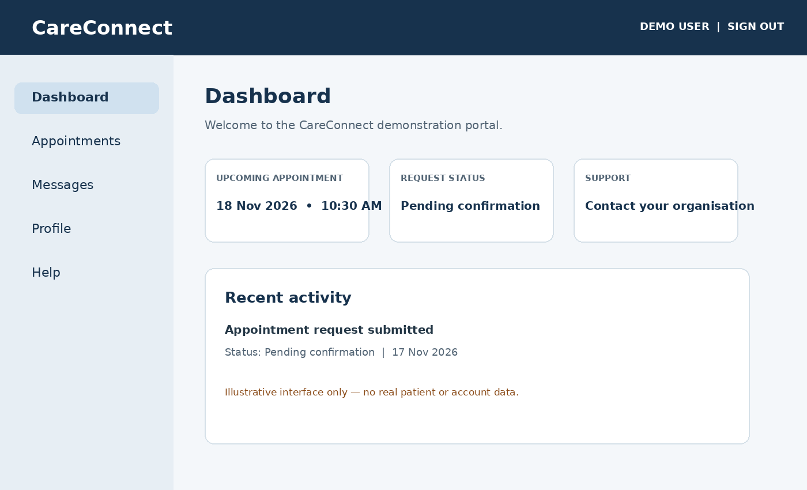

# CareConnect Demo Portal — Software User Guide

**Document ID:** CC-UG-001 | **Version:** 2.0 | **Status:** Demonstration draft  
**Audience:** Portal users with basic web-browser experience  
**Purpose:** Explain how to sign in, navigate the dashboard, review an appointment, submit a request, and sign out.

> **Scope warning:** CareConnect is fictional. This guide is not a description of a real healthcare system and must not be used to make clinical decisions. All screens and data are synthetic.

## 1. Before you begin
You need an account created through the organisation's approved process, access to the registered email address or verification method, a supported browser, and a reliable internet connection. Use a private device where possible.

**Protect your account:** Never share your password or one-time verification code. Support personnel should not ask you to send either item by email, chat, or ticket.

## 2. Sign in
1. Open the sign-in address supplied through the organisation's official channel.
2. Check the address carefully before entering account details.
3. Enter the email address associated with the demonstration account.
4. Enter the password privately.
5. Select **Sign in**.
6. If prompted, complete the on-screen verification step without sharing the code.

**Expected result:** The dashboard appears. If an error is displayed, note its wording but do not include passwords or verification codes in a support request.

## 3. Navigate the dashboard
| Area | What it contains | User action |
|---|---|---|
| Dashboard | Summary and navigation | Choose the task you want to complete |
| Appointments | Upcoming appointments and requests | Open an item to review its displayed details |
| Messages | Example service communications | Read messages and follow approved instructions |
| Profile | Basic account settings | Review permitted fields |
| Help | Support information | Use the official support route |

*Figure 1. Fictional dashboard mock-up using synthetic labels and data.*

## 4. Review an appointment
1. From the dashboard, select **Appointments**.
2. Open the **Upcoming** section.
3. Select the appointment entry you want to review.
4. Check the displayed date, time, location or connection instructions, and status.
5. If information appears incorrect, contact the organisation through its approved channel.

**Expected result:** The appointment details page displays the available information. Do not assume a requested change is confirmed until the organisation confirms it.

## 5. Submit an appointment request
1. Open **Appointments**.
2. Select **Request an appointment** (illustrative label).
3. Complete only the fields requested by the portal.
4. Review the information for accuracy.
5. Select **Submit request**.
6. Save or note the confirmation reference if one is displayed.

**Expected result:** The request is recorded as **Pending confirmation**. A submitted request is not a confirmed booking.

## 6. Sign out
1. Select **Sign out** from the account menu.
2. Wait for the sign-in page to appear.
3. If using a shared device, close the browser window after signing out.

## 7. Common questions
**Does “Pending confirmation” mean my appointment is booked?** No. It means the request was submitted but has not yet been confirmed.

**What if I cannot sign in?** Follow the [troubleshooting article](troubleshooting.md).

**Can I email my password to support?** No. Never send passwords or verification codes.

## 8. Accessibility and usability notes
- Use built-in heading styles and meaningful heading order in published formats.
- Ensure keyboard users can reach and identify interactive controls.
- Provide text alternatives for meaningful images; decorative images should be marked appropriately in the final format.
- Do not rely on colour alone to communicate appointment status.
- Use descriptive link text and plain language.
- Verify contrast, zoom/reflow, screen-reader reading order, and form labels against the applicable standard before publication.

## 9. Validation and maintenance
A product owner or authorised subject-matter expert must validate interface labels, workflows, policies, and support routes before this guide is used for a live service. Review it whenever the sign-in process, navigation, appointment workflow, or user-facing policy changes.

## 10. Revision history
| Version | Change |
|---|---|
| 1.0 | Initial demonstration draft |
| 2.0 | Expanded task workflows, expected results, illustrative visual, security notes, and accessibility review points |
